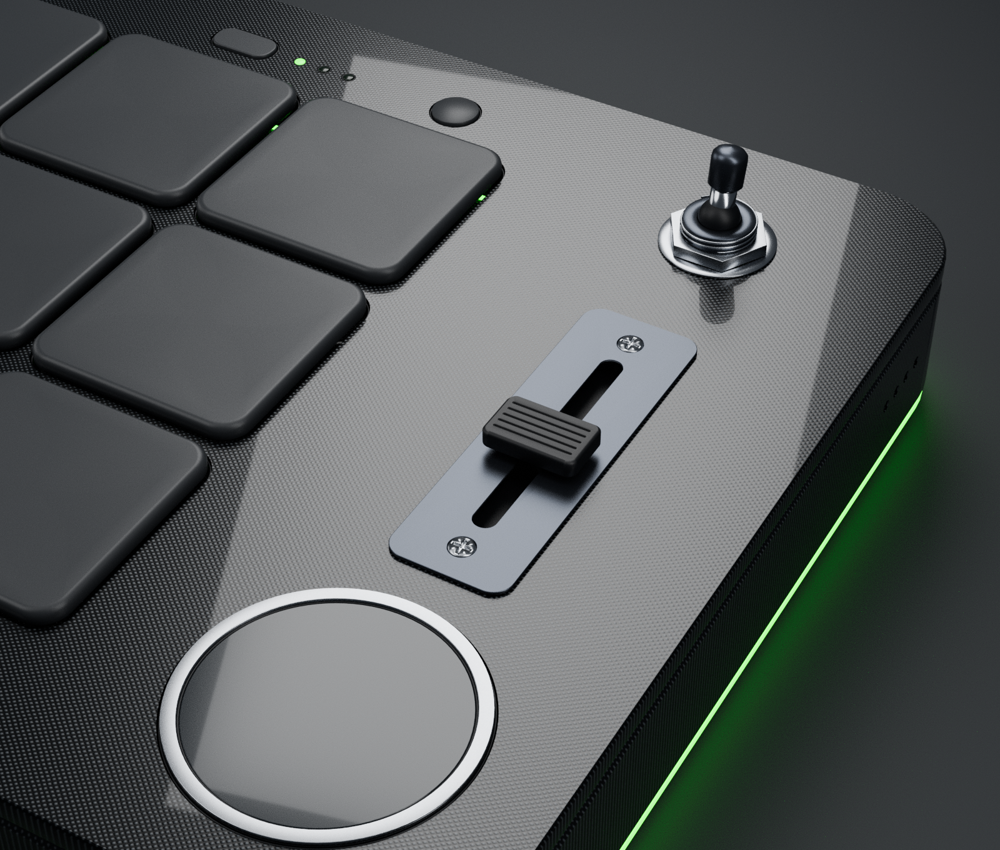
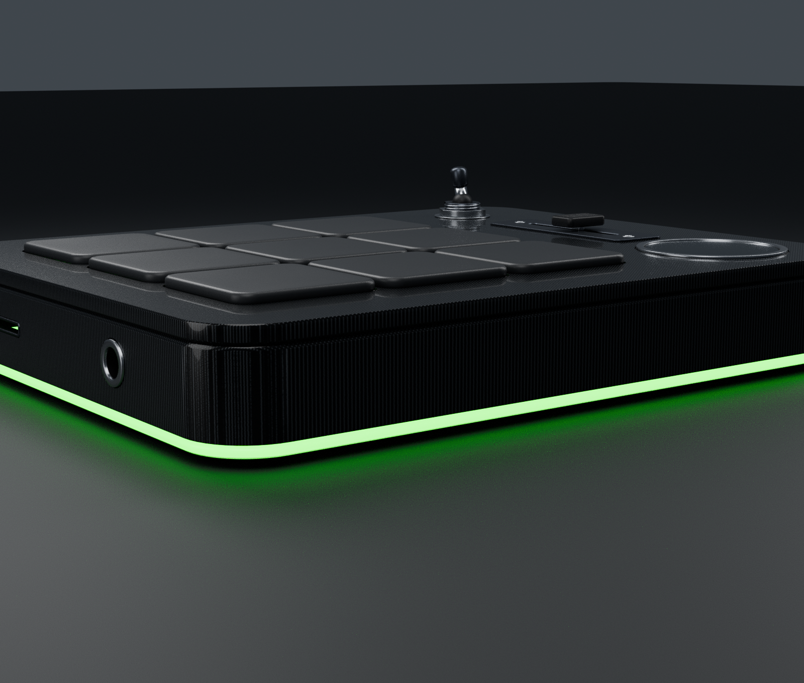
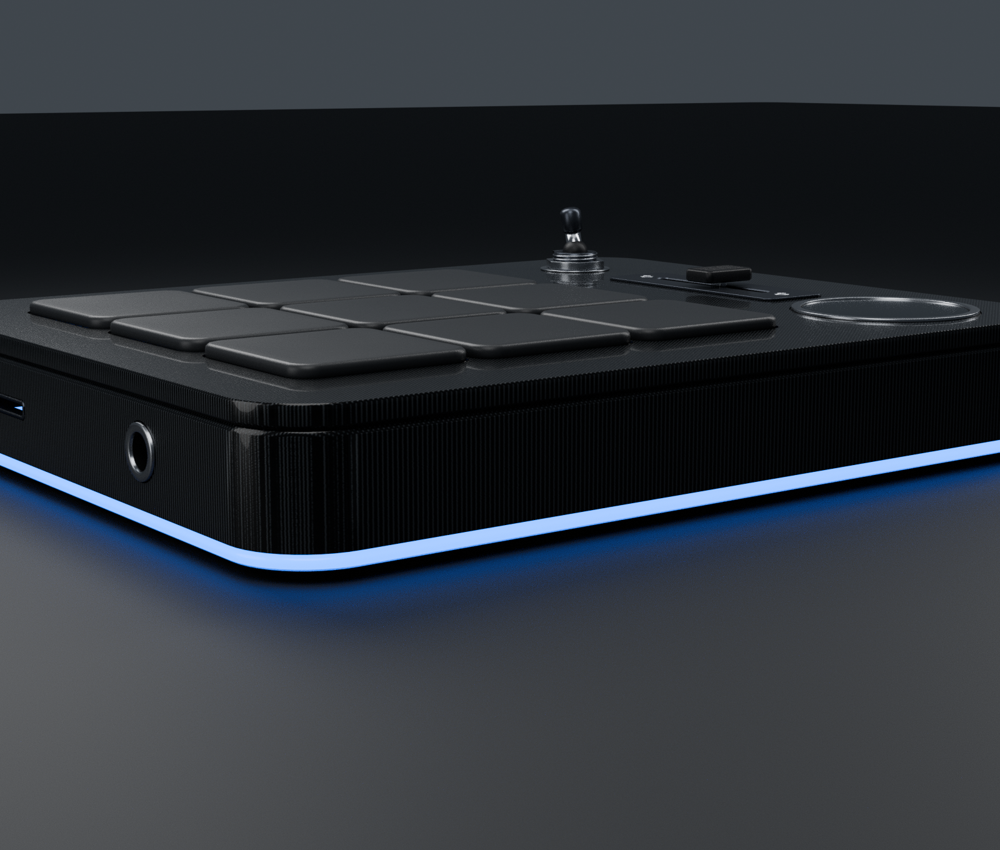
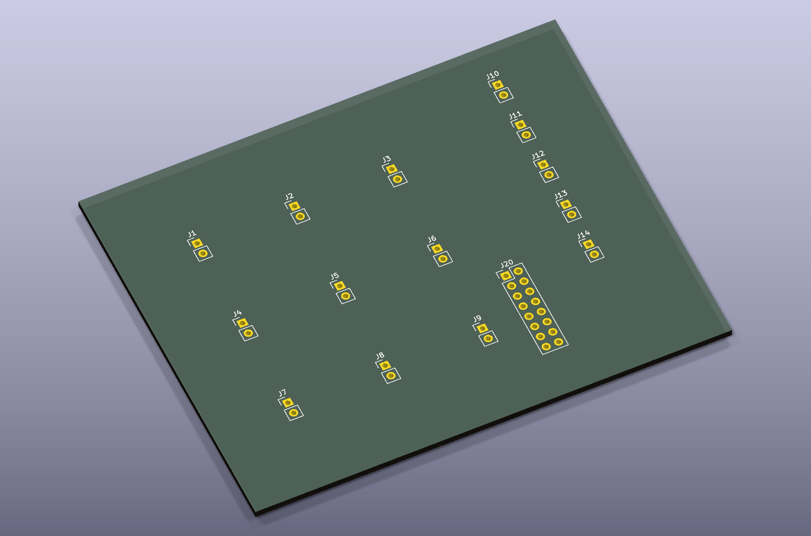
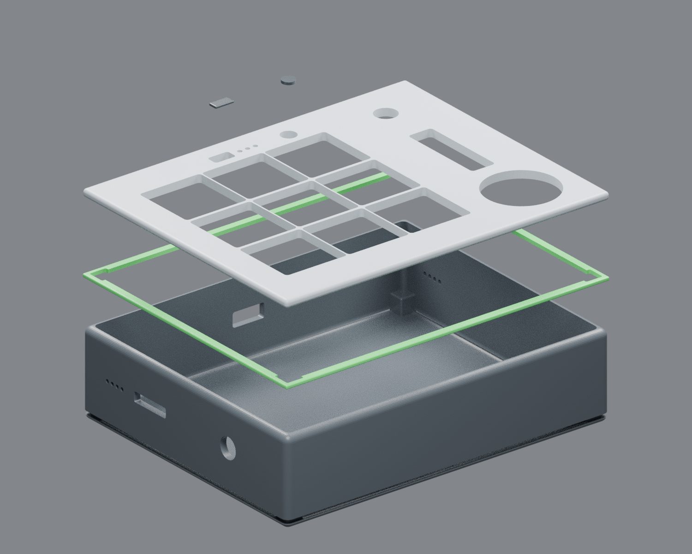
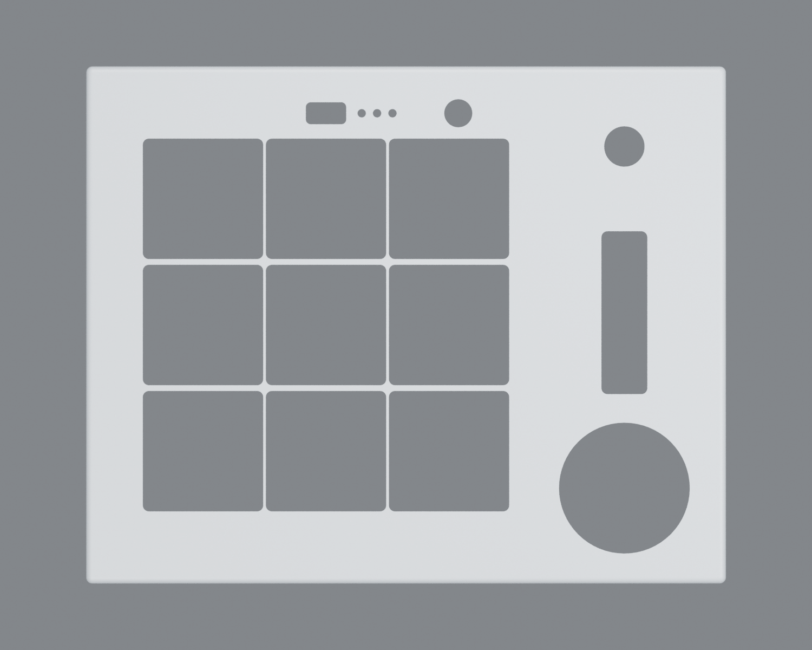

# CorePad — Beta Carbon

Macropad USB-C com **9 teclas em 3 × 3**, biometria, controle de áudio e gravação de reuniões. A linha escolhida para desenvolvimento é a **Beta**, com acabamento em aparência de fibra de carbono e faixa RGB configurável exclusivamente na base.


## Produto: vistas técnicas

As vistas vêm do modelo editável [Beta 1.0.0](beta_blender/Beta_v1.0.0.blend). Elas mostram a organização visual escolhida; o empilhamento interno ainda está em desenvolvimento.

| Vista superior | Controles e biometria |
|---|---|
|  |  |
| Nove teclas sem inscrições, seletor, três indicadores e botão de gravação. | Fader vertical e mudo à direita, com sensor biométrico acessível. |

| Lateral esquerda | Traseira |
|---|---|
|  |  |
| P2 e microSD na lateral esquerda. | USB-C exclusivamente na borda traseira. |

| RGB na base — verde | RGB na base — azul |
|---|---|
|  |  |
| Luz difusa junto à mesa, sem linha verde superior. | A cena demonstra a variação de cor pretendida para o software. |

## PCB: estado atual dos arquivos KiCad

Renders das placas nuas gerados diretamente dos projetos KiCad da revisão 0.2.0. Mostram pads, furos e serigrafia; modelos 3D dos componentes de catálogo não estão incluídos no ambiente de renderização. A ausência de trilhas corresponde ao estado real do projeto.

| Interface de bancada | Placa principal em estudo |
|---|---|
|  |  |
| 15 footprints de conectores, 44 pinos conferidos com o esquema e redes atribuídas. ERC sem erros/avisos; 29 conexões ainda sem trilhas. | Contorno e footprint do STM32U5A5. Áudio, alimentação, segurança, esquema completo e roteamento ainda pendentes. |

A interface usa chicotes para os controles externos e serve à bancada; a placa superior definitiva ainda precisa ser projetada. **As placas atuais não estão liberadas para fabricação.**

- [Interface: esquema](development/hardware/v0.2.0/CorePad_Interface_Bancada_v0.2.0.kicad_sch) e [PCB](development/hardware/v0.2.0/CorePad_Interface_Bancada_v0.2.0.kicad_pcb).
- [Principal: PCB em estudo](development/hardware/v0.2.0/CorePad_Principal_v0.2.0.kicad_pcb).
- [BOM por bloco](development/hardware/v0.2.0/BOM.md), [arquitetura de referência](development/hardware/v0.2.0/ARCHITECTURE_REFERENCE.md) e [relatórios ERC/DRC](development/hardware/v0.2.0/reports/).

## Peças plásticas: vistas de engenharia

Renders derivados da [montagem mecânica editável](development/mechanical/v0.1.0/Beta_Pecas_v0.1.0.blend), revisão 0.1.0. As peças são mostradas sem revestimento decorativo para facilitar a leitura dos recortes e volumes.



**Vista explodida:** base isolante, difusor perimetral destacado em verde, tampa com recortes e dois botões. As separações verticais servem à visualização da montagem.

| Interior da base | Tampa vista de cima |
|---|---|
|  |  |
| Canal do difusor, pontes estruturais e aberturas de conectores/microfones. | Recortes das nove teclas, biometria, fader, chave, seletor, LEDs e gravação. |

O estudo mecânico usa **104 × 84 × 28,4 mm**, excluindo comandos. A espessura é exploratória e difere do modelo visual Beta. Cada STL contém um sólido fechado; fixações, suportes de PCB, retenções e tolerâncias dos componentes ainda precisam ser fechados.

[Base STL](development/mechanical/v0.1.0/Base_plastica.stl) · [Tampa STL](development/mechanical/v0.1.0/Tampa_carbono.stl) · [Difusor STL](development/mechanical/v0.1.0/Difusor_RGB.stl) · [Botão de camada STL](development/mechanical/v0.1.0/Botao_camada.stl) · [Botão de gravação STL](development/mechanical/v0.1.0/Botao_gravacao.stl)

## Software e verificação

O [firmware C11](development/firmware/) contém o núcleo de estados de camadas, cartão, RGB e bateria baixa, testado em host e compilado para Cortex-M33. O [configurador desktop](development/software/configurator.py) edita as 18 macros comuns e RGB, salva JSON e aplica a configuração a um simulador. USB físico, drivers de áudio/cartão, biometria segura e FIDO2 continuam em desenvolvimento.

```sh
make -C development/firmware test arm
python3 -m unittest discover -s development/tests -v
python3 development/software/configurator.py
```

Consulte [resultados de validação](development/VALIDATION.md), [estado atual](docs/STATUS.md) e [roteiro](docs/ROADMAP.md). A autonomia de 30 horas permanece como meta de ensaio.

## Continuar o desenvolvimento

Comece por [CLAUDE.md](CLAUDE.md), pela [especificação vigente](Especificacao_Produto_Macropad_Biometrico_Gravador_2026-11-21.md) e pelo [guia integrado](development/README.md).

| Caminho | Conteúdo ativo |
|---|---|
| `beta_blender/` | Design Beta carbon, gerador e vistas do produto |
| `development/hardware/` | KiCad, BOM, arquitetura e relatórios |
| `development/firmware/` | Núcleo C e testes |
| `development/software/` | Configurador, protocolo e referência RF64 |
| `development/mechanical/` | Montagem Blender, STL e gerador das peças |
| `docs/` | Estado, roteiro, renders técnicos e scripts de renderização |
| `.old/` | Alpha, conceitos substituídos e duplicatas; somente histórico |

As fontes dos renders e os comandos para reproduzi-los estão em [docs/render/README.md](docs/render/README.md). Revisões entregues devem ser preservadas, com novas versões em `MAJOR.MINOR.PATCH`.

Projeto privado em desenvolvimento. Nenhuma licença de distribuição foi concedida.
