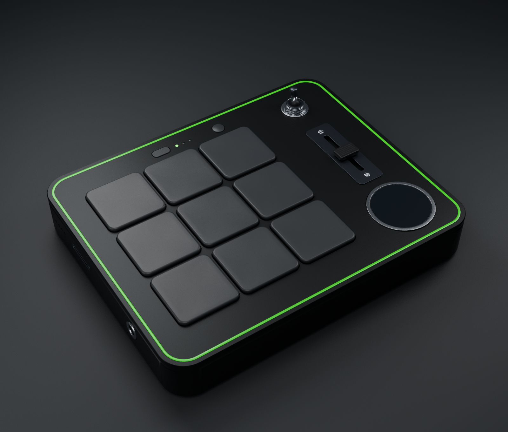

# CorePad

Macropad USB-C compacto com nove teclas em matriz 3 × 3, autenticação biométrica, controle de áudio e gravação de reuniões. **CorePad** é o nome do produto; **Alpha** é a proposta visual escolhida e identifica os arquivos de modelagem.

## Onde o projeto está

- **Especificação vigente:** [versão 0.5](Especificacao_Produto_Macropad_Biometrico_Gravador_2026-11-21.md), consolidada em 21/11/2026 e atualizada em 22/11/2026.
- **Referência visual aprovada:** [`Alpha_v1.2.0.blend`](alpha_blender/Alpha_v1.2.0.blend), com gerador e renders preservados.
- **Eletrônica:** revisão exploratória [`0.1.0`](alpha_eletronica/v0.1.0/Alpha_Eletronica_v0.1.0.md), ainda sem esquema elétrico completo, redes ou trilhas.
- **Próximo marco:** validar a arquitetura em bancada e produzir a revisão eletrônica 0.2.0 com pinagem, esquemas e BOM fechada para protótipo.

> Os arquivos KiCad atuais são estudos de posicionamento. **Não estão liberados para fabricação.** A meta de 30 horas de gravação com bateria interna depende de medição em protótipo.

## Começar pelo Claude

Abra este repositório no Claude Code e peça para ele ler [`CLAUDE.md`](CLAUDE.md) antes de propor ou alterar qualquer coisa. O arquivo contém a ordem das fontes, limites do estado atual, convenções de versionamento e o fluxo esperado para cada sessão.

Depois consulte:

1. [`docs/STATUS.md`](docs/STATUS.md) — estado verificável e principais riscos;
2. [`docs/ROADMAP.md`](docs/ROADMAP.md) — etapas, entregáveis e critérios de saída;
3. [especificação do produto](Especificacao_Produto_Macropad_Biometrico_Gravador_2026-11-21.md) — requisitos aprovados e pontos ainda abertos;
4. [estudo eletrônico 0.1.0](alpha_eletronica/v0.1.0/Alpha_Eletronica_v0.1.0.md) — arquitetura proposta e fontes técnicas.

## Estrutura

| Caminho | Conteúdo | Autoridade |
|---|---|---|
| `Especificacao_Produto_...md` | Requisitos e decisões do produto | Fonte principal do escopo |
| `alpha_blender/` | Modelos, geradores, validações e renders Alpha | Referência visual aprovada |
| `alpha_eletronica/` | Arquitetura, BOM, KiCad, cálculos e verificações | Engenharia preliminar |
| `docs/` | Status operacional e roteiro de desenvolvimento | Guia de continuidade |
| `archive/` | Estudos descartados, imagens geradas e versões históricas | Consulta histórica; não usar como requisito |

## Regras de versão

- Blender: `Alpha_vMAJOR.MINOR.PATCH.*`.
- Eletrônica: diretório `alpha_eletronica/vMAJOR.MINOR.PATCH/`, com numeração independente.
- Nunca sobrescrever uma revisão entregue; criar a próxima versão e preservar a anterior.
- Atualizar `README.md`, `docs/STATUS.md` e os arquivos de verificação ao fechar um marco.

Projeto privado e em desenvolvimento. Nenhuma licença de distribuição foi concedida.
