# CorePad — Beta Carbon

Macropad USB-C com **9 teclas em 3 × 3**, biometria, controle de áudio e gravação de reuniões. A linha escolhida para desenvolvimento é a **Beta**, com acabamento em aparência de fibra de carbono e faixa RGB configurável exclusivamente na base.

O [Caderno de Engenharia Rev. A em PDF](docs/engineering/Rev_A/CorePad_Caderno_de_Engenharia_Rev_A.pdf) consolida requisitos, eletrônica, mecânica, firmware, software, qualidade, riscos e pendências em 65 lâminas A3. Consulte o [índice e instruções de reprodução](docs/engineering/Rev_A/README.md). O caderno é uma linha de base de engenharia; fabricação permanece bloqueada pelos itens “A DEFINIR”.

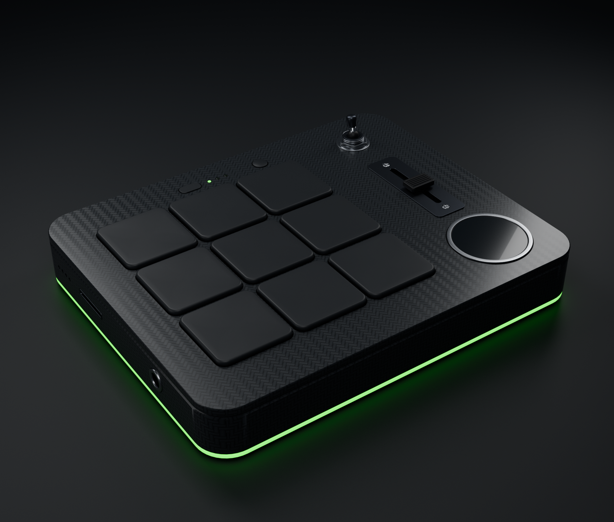

## RGB — cinco cores

Galeria da [Beta 1.0.1](beta_blender/Beta_v1.0.1.blend), renderizada em 2000 × 1700 pixels com a mesma câmera e iluminação. A revisão refina a trama twill 2 × 2 de carbono, filamentos, resina, microtexturas e reflexos, e acrescenta um anteparo interno à faixa RGB.

| Laranja | Amarelo |
|---|---|
| 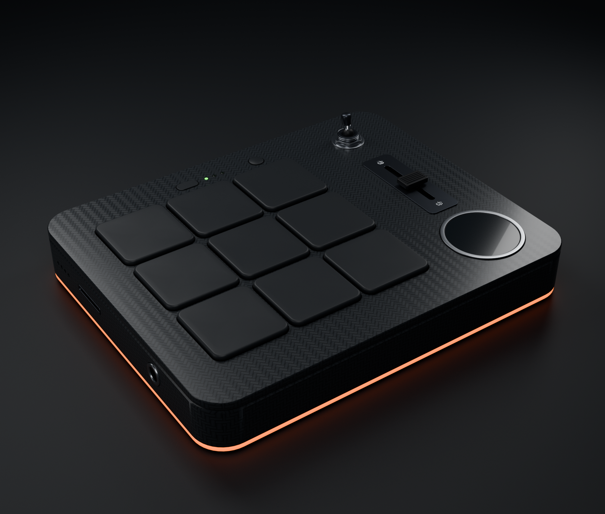 | 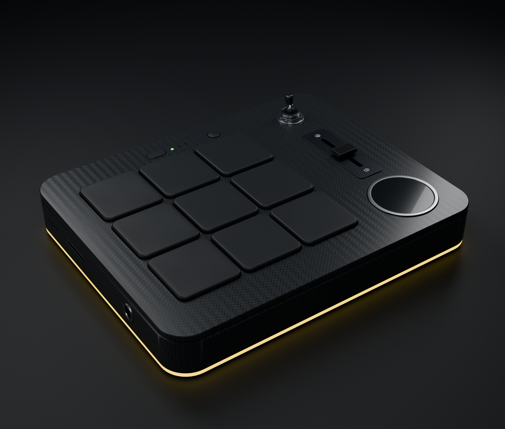 |
| Cor de referência sRGB `#FF6A00`. | Cor de referência sRGB `#FFD500`. |

| Verde | Vermelho |
|---|---|
|  | 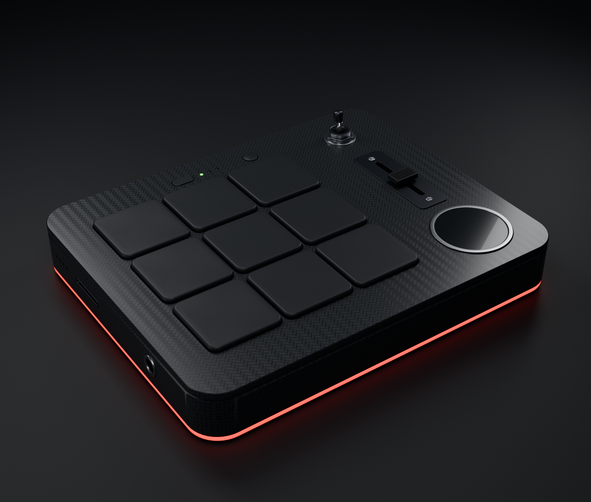 |
| Cor de referência sRGB `#00FF00`. | Cor de referência sRGB `#FF1200`. |

**Azul — referência sRGB `#0066FF`**

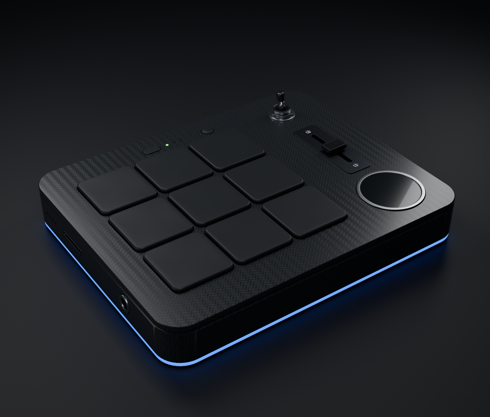

## Produto: vistas técnicas

As vistas de topo, lateral e traseira preservam a documentação geométrica da [Beta 1.0.0](beta_blender/Beta_v1.0.0.blend); o detalhe dos controles usa os materiais refinados da [Beta 1.0.1](beta_blender/Beta_v1.0.1.blend). Elas mostram a organização visual escolhida; o empilhamento interno ainda está em desenvolvimento.

| Vista superior | Controles e biometria |
|---|---|
| 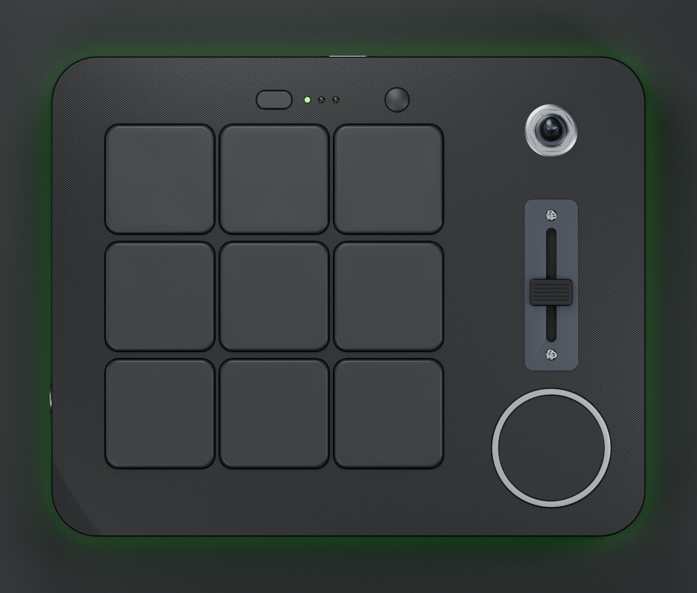 | 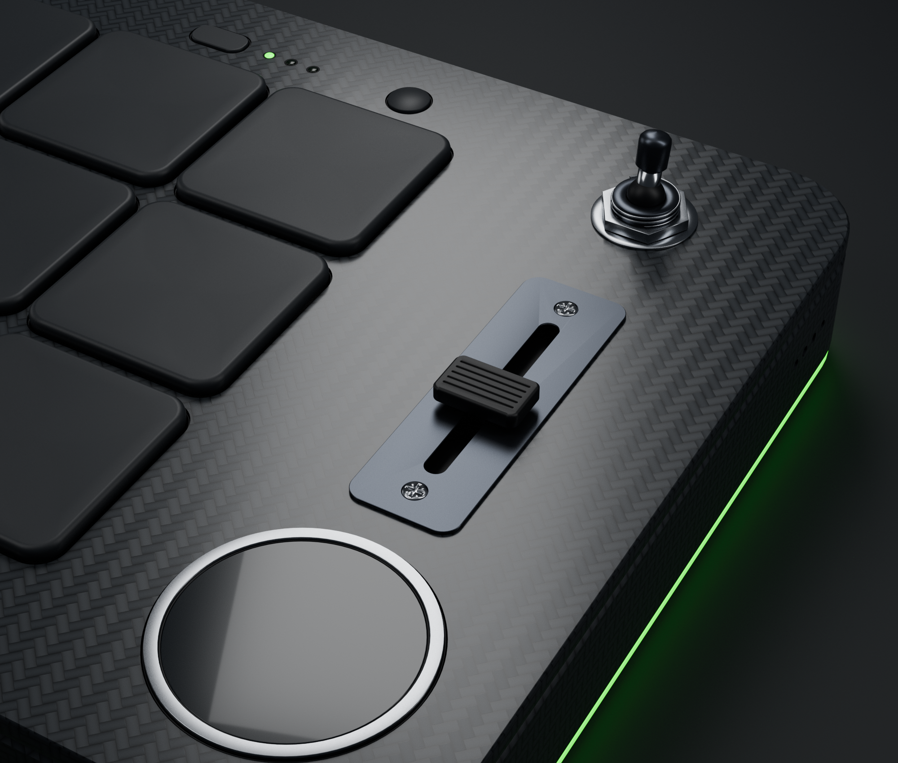 |
| Nove teclas sem inscrições, seletor, três indicadores e botão de gravação. | Fader vertical e mudo à direita, com sensor biométrico acessível. |

| Lateral esquerda | Traseira |
|---|---|
| 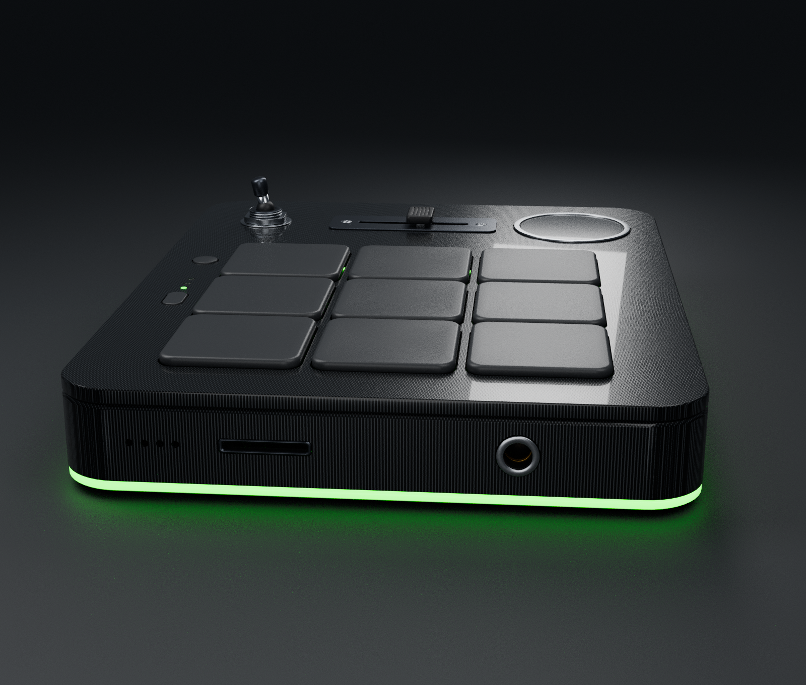 | 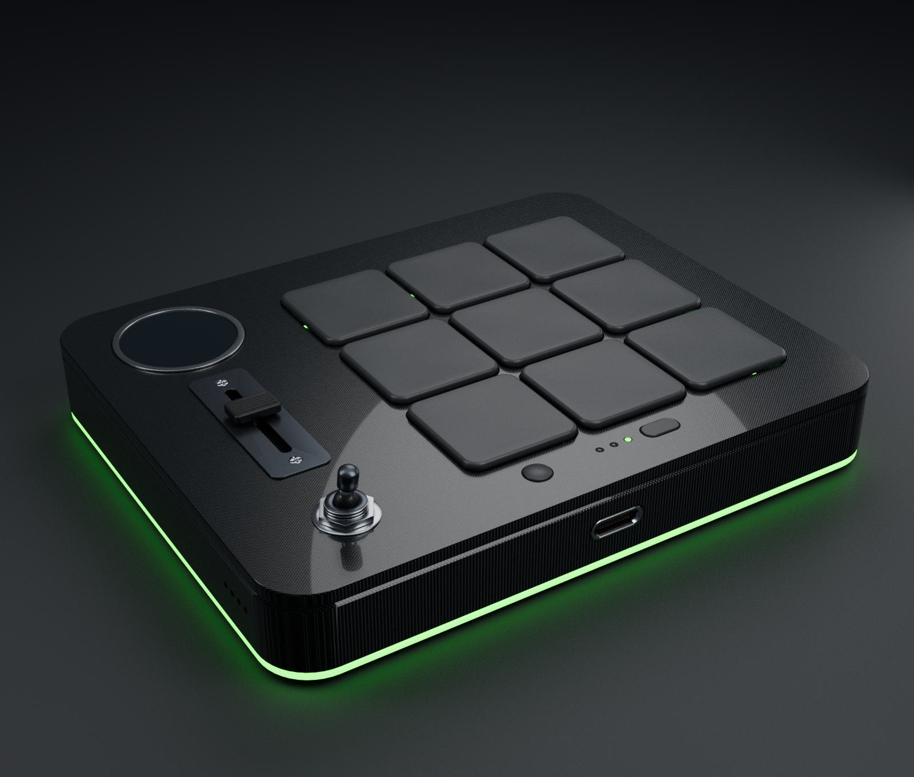 |
| P2 e microSD na lateral esquerda. | USB-C exclusivamente na borda traseira. |

**Detalhe da base — Beta 1.0.1**

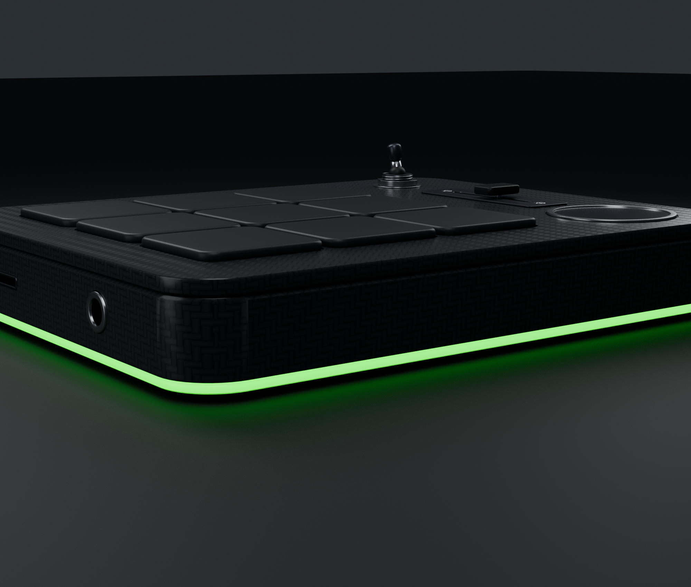

Luz difusa junto à mesa, com anteparo interno e sem linha verde superior.

## PCB: estado atual dos arquivos KiCad

**Revisão ativa 0.3.0 — placas e encaixe:** a [PCB UI de duas camadas](development/hardware/v0.3.0/CorePad_UI_v0.3.0.kicad_pcb) contém nove footprints piloto Kailh Choc V2, FFC de 24 vias e **seis de nove sinais de teclas roteados**. A [PCB principal de quatro camadas](development/hardware/v0.3.0/CorePad_Main_v0.3.0.kicad_pcb) posiciona MCU, codec, amplificador, USB-C, microSD, P2 e FFC com footprints candidatos; não possui circuito completo nem trilhas funcionais. Consulte o [guia eletrônico](development/hardware/v0.3.0/README.md), a [pinagem proposta](development/hardware/v0.3.0/interconnect_24.json), a [BOM atualizada dos componentes posicionados](development/hardware/v0.3.0/BOM_DELTA.md) e os relatórios DRC: [UI](development/hardware/v0.3.0/ui_drc.txt) e [principal](development/hardware/v0.3.0/main_drc.txt).

| Trilhas piloto da UI | Componentes candidatos na principal |
|---|---|
| 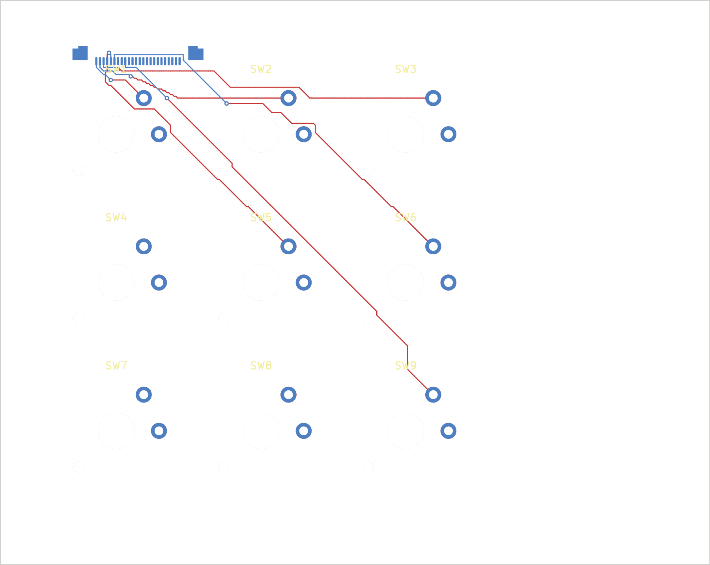 |  |
| Três sinais de tecla e terra ainda abertos; DRC sem violações geométricas. | Posicionamento apenas; DRC com 8 violações, sem esquema completo. |

O [conjunto STEP integrado 0.2.0](development/integration/v0.2.0/CorePad_Beta_PCB_match_v0.2.0.step) substitui as placas nuas anteriores pelas exportações KiCad 0.3.0 e adiciona envelopes dos componentes e FFC. O [relatório de encaixe](development/integration/v0.2.0/README.md) identifica **choques do USB-C e microSD com a base**, desvio vertical **2,41 mm** entre P2 e abertura, ausência de suportes das placas e dobra do FFC ainda não comprovada. Esses achados impedem liberação para fabricação.


### Estudos anteriores

Os renders abaixo mostram o estudo 0.2.0 de bancada e posicionamento anterior. Não representam as placas ativas 0.3.0.

| Interface de bancada | Placa principal em estudo |
|---|---|
|  | 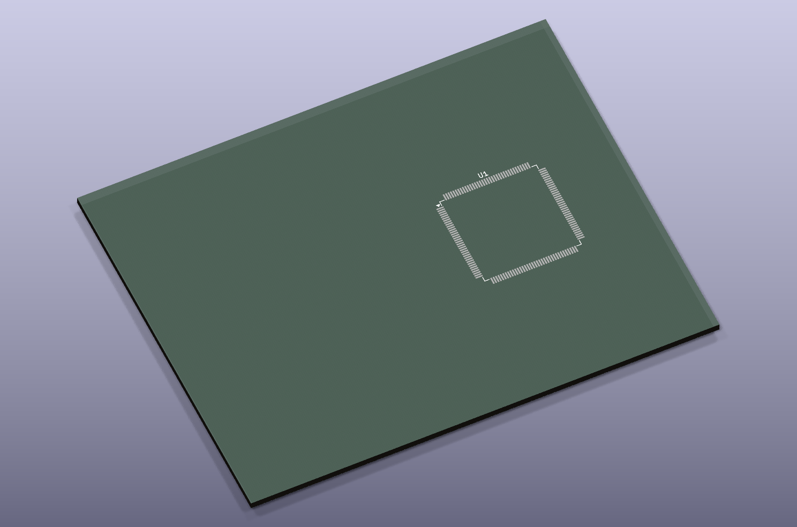 |
| 15 footprints de conectores, 44 pinos conferidos com o esquema e redes atribuídas. ERC sem erros/avisos; 29 conexões ainda sem trilhas. | Contorno e footprint do STM32U5A5. Áudio, alimentação, segurança, esquema completo e roteamento ainda pendentes. |

A interface usa chicotes para os controles externos e serve à bancada; a placa superior definitiva ainda precisa ser projetada. **As placas atuais não estão liberadas para fabricação.**

O [arquivo KiCad de posicionamento da PCB UI](development/hardware/ui_mechanical/v0.1.0/CorePad_UI_Posicionamento_v0.1.0.kicad_pcb) registra contorno e centros de teclas/controles na mesma referência do 3D; não tem pads, trilhas ou esquema.

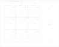

**PCB UI mecânica:** nove centros SW1–SW9 e posições de controles; os retângulos mostram janelas da tampa, não footprints de solda.

- [Interface: esquema](development/hardware/v0.2.0/CorePad_Interface_Bancada_v0.2.0.kicad_sch) e [PCB](development/hardware/v0.2.0/CorePad_Interface_Bancada_v0.2.0.kicad_pcb).
- [Principal: PCB em estudo](development/hardware/v0.2.0/CorePad_Principal_v0.2.0.kicad_pcb).
- [BOM por bloco](development/hardware/v0.2.0/BOM.md), [arquitetura de referência](development/hardware/v0.2.0/ARCHITECTURE_REFERENCE.md) e [relatórios ERC/DRC](development/hardware/v0.2.0/reports/).

## Peças plásticas: vistas de engenharia

Renders derivados da [montagem mecânica editável](development/mechanical/v0.1.0/Beta_Pecas_v0.1.0.blend), revisão 0.1.0. As peças são mostradas sem revestimento decorativo para facilitar a leitura dos recortes e volumes.


**Vista explodida:** base isolante, difusor perimetral destacado em verde, tampa com recortes e dois botões. As separações verticais servem à visualização da montagem.

| Interior da base | Tampa vista de cima |
|---|---|
| 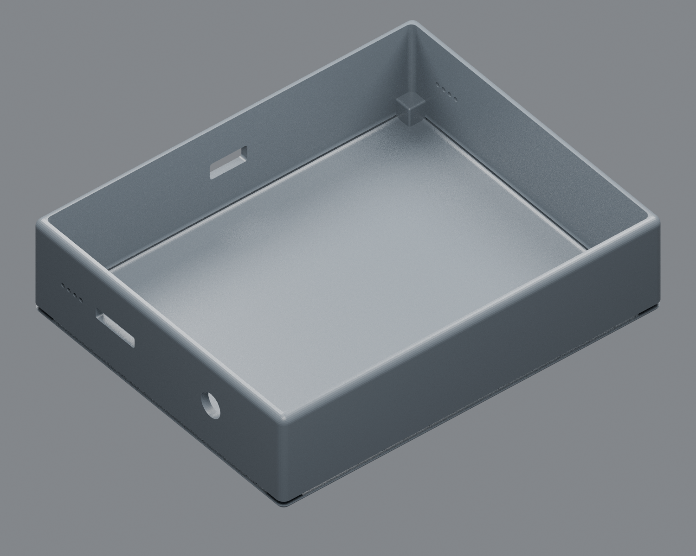 |  |
| Canal do difusor, pontes estruturais e aberturas de conectores/microfones. | Recortes das nove teclas, biometria, fader, chave, seletor, LEDs e gravação. |

O estudo mecânico usa **104 × 84 × 28,4 mm**, excluindo comandos. A espessura é exploratória e difere do modelo visual Beta. Cada STL contém um sólido fechado; fixações, suportes de PCB, retenções e tolerâncias dos componentes ainda precisam ser fechados.

## Montagem 3D integrada e desenhos — estudo anterior 0.1.0

O [conjunto STEP 0.1.0](development/integration/v0.1.0/CorePad_Beta_integrado_v0.1.0.step) documenta a geometria original da base, tampa, difusor, bateria e cabos. Usa a [PCB UI mecânica anterior](development/hardware/ui_mechanical/v0.1.0/CorePad_UI_Posicionamento_v0.1.0.kicad_pcb), sem pads/trilhas. A [fonte paramétrica](development/integration/v0.1.0/build_assembly.py), [peças STEP/STL](development/integration/v0.1.0/parts/), [manifesto](development/integration/v0.1.0/assembly_manifest.json) e [relatório anterior](development/integration/v0.1.0/fit_report.json) permanecem como histórico de engenharia. Para conferir a eletrônica atual com a caixa, use a **revisão 0.2.0** ligada acima.

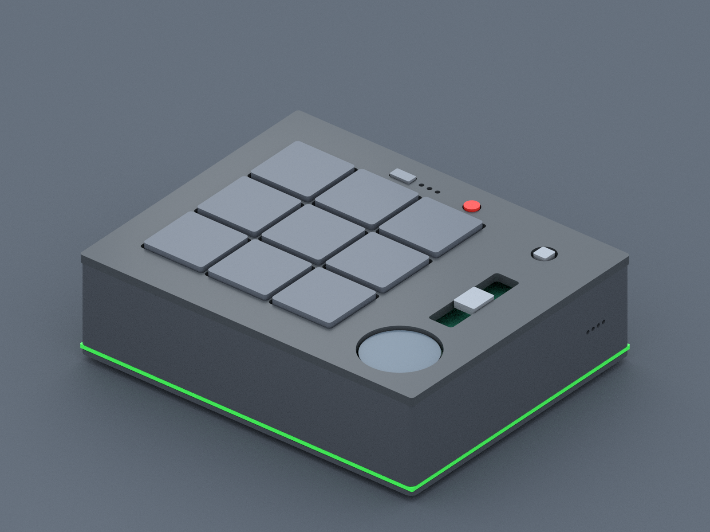

**Conjunto montado:** caixa, placas, bateria, controles e cabos na posição nominal. A vista não prova encaixe de componentes de fornecedor.

As vistas de engenharia usam cinza neutro para leitura das peças; o acabamento escolhido continua sendo o carbono da galeria Beta 1.0.1 acima.

| Montagem explodida | Corpo aberto em posição montada |
|---|---|
| 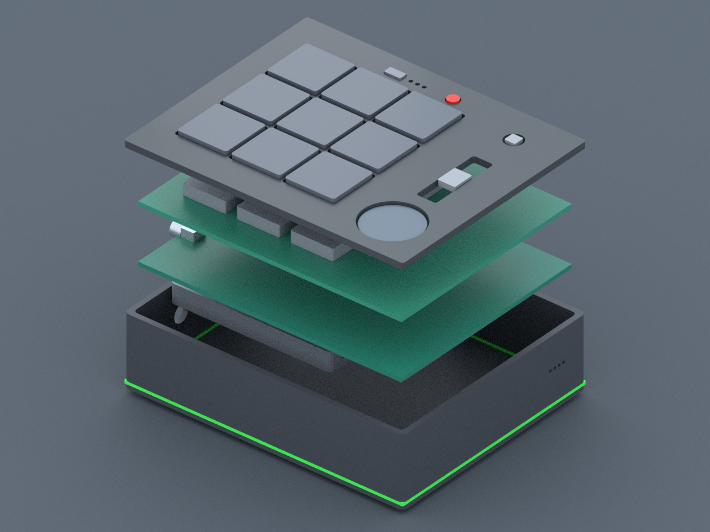 | 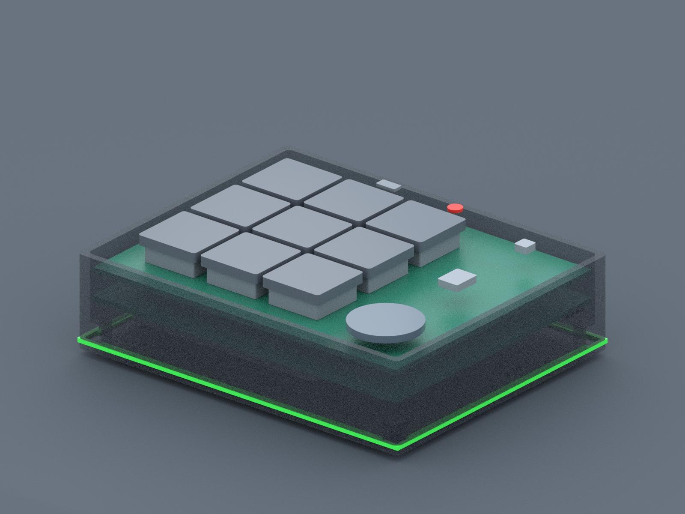 |
| Vista para ler o empilhamento de tampa, PCB UI, PCB principal, bateria e base. | Base transparente de inspeção; conectores e cabos estão em posição proposta. |

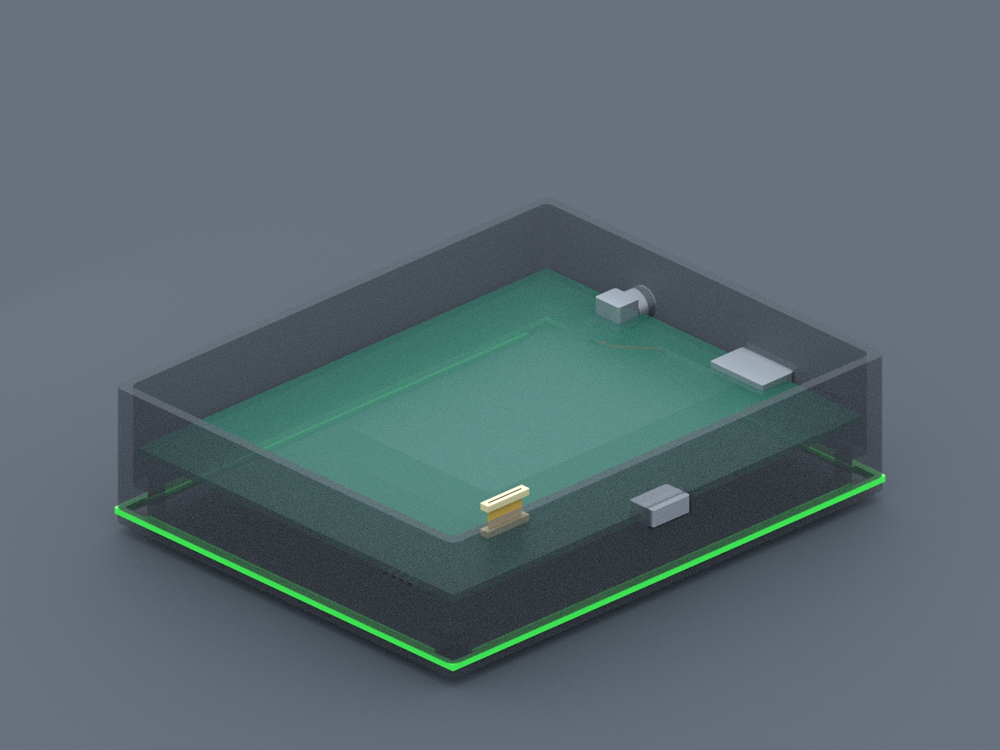

**Passagem proposta:** a vista isola o FFC de 16 sinais e os dois fios da bateria; PCB UI, tampa e comandos foram ocultados apenas para inspeção. Conectores, terminação, comprimento e raio de dobra ainda não foram escolhidos.

| Planta cotada preliminar | Seção do empilhamento preliminar |
|---|---|
| 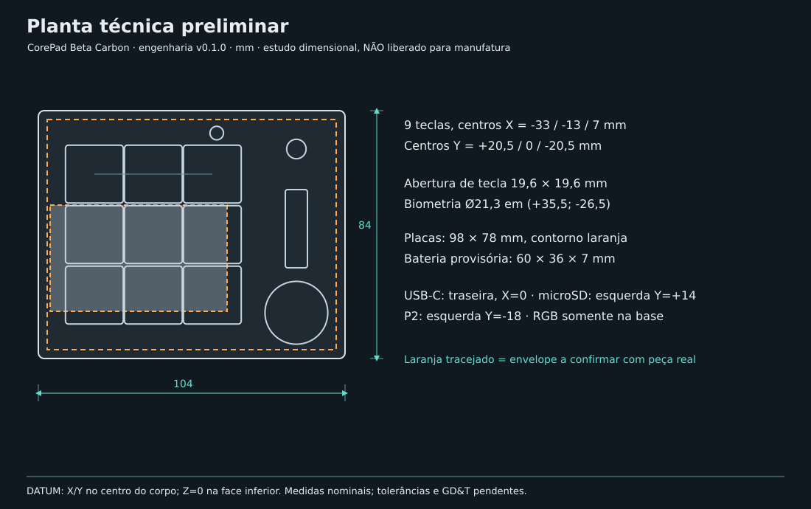 | 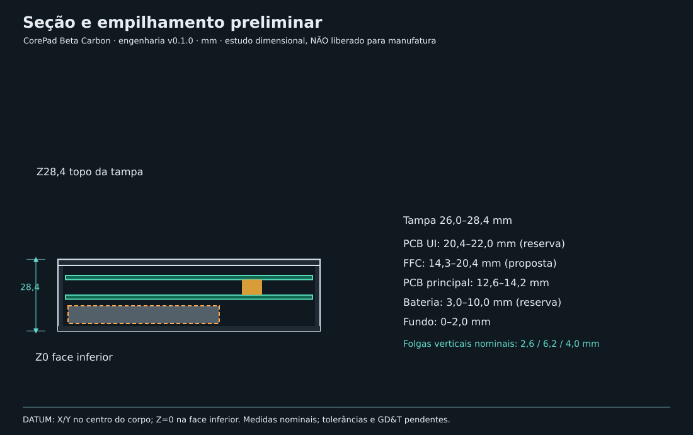 |
| Envelope 104 × 84 mm e localização de controles. | Alturas das placas, bateria, tampa e folgas nominais. |

Consulte a [BOM mecânica e de cabos](development/integration/v0.1.0/BOM_MECANICA_CABOS.md) e o [índice de liberação de manufatura](development/integration/v0.1.0/LIBERACAO_MANUFATURA.md). Os desenhos são estudo dimensional; **não são desenhos liberados para fabricar**.

[Base STL](development/mechanical/v0.1.0/Base_plastica.stl) · [Tampa STL](development/mechanical/v0.1.0/Tampa_carbono.stl) · [Difusor STL](development/mechanical/v0.1.0/Difusor_RGB.stl) · [Botão de camada STL](development/mechanical/v0.1.0/Botao_camada.stl) · [Botão de gravação STL](development/mechanical/v0.1.0/Botao_gravacao.stl)

## Software e verificação

O [firmware C11](development/firmware/) contém o núcleo de estados de camadas, cartão, RGB e bateria baixa, testado em host e compilado para Cortex-M33. O [configurador desktop](development/software/configurator.py) edita as 18 macros comuns e RGB, salva JSON e aplica a configuração a um simulador. USB físico, drivers de áudio/cartão, biometria segura e FIDO2 continuam em desenvolvimento.

O [enquadramento de configuração pública](development/software/wire_protocol.py) já valida versão, tamanho, ID de mensagem e CRC32 antes de entregar comandos ao simulador. Ainda não é comunicação USB de produto.

```sh
make -C development/firmware test arm
python3 -m unittest discover -s development/tests -v
python3 development/software/configurator.py
```

Consulte [resultados de validação](development/VALIDATION.md), [estado atual](docs/STATUS.md) e [roteiro](docs/ROADMAP.md). A autonomia de 30 horas permanece como meta de ensaio.

## Continuar o desenvolvimento

Comece por [CLAUDE.md](CLAUDE.md), pela [especificação vigente](Especificacao_Produto_Macropad_Biometrico_Gravador_2026-11-21.md) e pelo [guia integrado](development/README.md).

| Caminho | Conteúdo ativo |
|---|---|
| `beta_blender/` | Design Beta carbon, gerador e vistas do produto |
| `development/hardware/` | KiCad, BOM, arquitetura e relatórios |
| `development/firmware/` | Núcleo C e testes |
| `development/software/` | Configurador, protocolo e referência RF64 |
| `development/mechanical/` | Montagem Blender, STL e gerador das peças |
| `development/integration/` | Conjunto CAD integrado, desenhos, encaixe e BOM mecânica/chicotes |
| `docs/` | Estado, roteiro, renders técnicos e scripts de renderização |
| `.old/` | Alpha, conceitos substituídos e duplicatas; somente histórico |

As fontes dos renders e os comandos para reproduzi-los estão em [docs/render/README.md](docs/render/README.md). Revisões entregues devem ser preservadas, com novas versões em `MAJOR.MINOR.PATCH`.

Projeto privado em desenvolvimento. Nenhuma licença de distribuição foi concedida.
