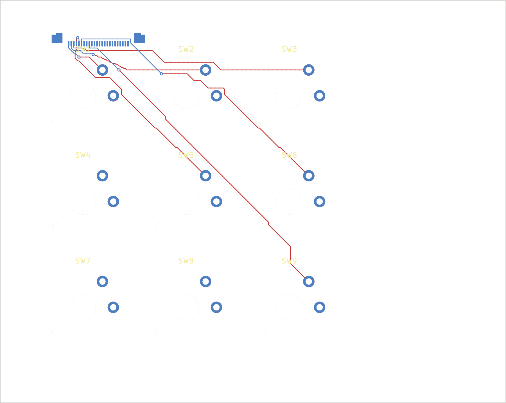
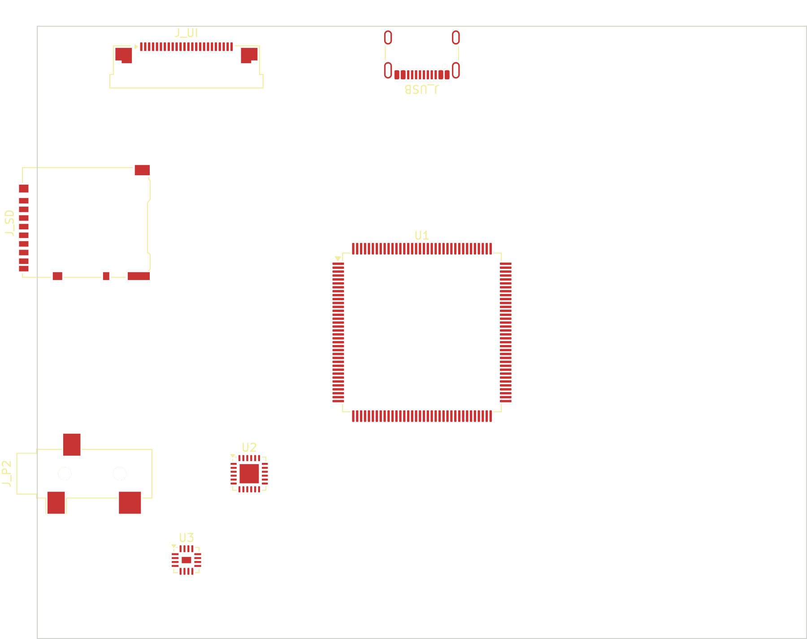

# CorePad Beta Carbon — eletrônica 0.3.0

Revisão de **posicionamento eletromecânico e roteamento piloto**, não um pacote de fabricação. A placa principal tem footprints de componentes candidatos e redes de portas; ainda não tem esquema elétrico completo, ligação pino a pino do MCU, alimentação, proteção, vias de terra ou trilhas funcionais. A placa de interface tem nove footprints piloto de switch, FFC de 24 vias e seis sinais de tecla roteados. Os DRCs são preservados sem exclusões.

## Arquivos

| Arquivo | Conteúdo |
|---|---|
| `CorePad_UI_v0.3.0.kicad_pcb` | Placa de 98 × 78 mm, duas camadas; SW1–9 e J_UI; KEY1, 2, 3, 5, 6 e 9 roteadas |
| `CorePad_Main_v0.3.0.kicad_pcb` | Placa de 98 × 78 mm, quatro camadas; MCU, codec, amplificador, USB-C, microSD, P2, FFC |
| `interconnect_24.json` | Alocação elétrica proposta de pinos do cabo flexível |
| `BOM_DELTA.md` | Componentes colocados ou alterados frente à BOM funcional 0.2.0 |
| `switch_placement.json` | Centros, envelope e terminais dos nove switches |
| `CorePad.pretty/` | Footprint **piloto** Choc V2 baseado em desenho do fabricante; espelhamento e pinos a conferir com amostra |
| `ui_drc.txt`, `main_drc.txt` | Relatórios completos de 22/11/2026 |
| `build_pcbs.py`, `route_ui.py` | Fontes para regenerar as placas e trilhas piloto |

Vermelho: F.Cu; azul: B.Cu. Há seis rotas completas e três abertas. As trilhas estreitas de `0,15 mm`, clearance de `0,20 mm` e vias `0,60/0,30 mm` são **parâmetros do estudo**, não requisitos liberados ao fabricante. O roteador usa malha de `0,25 mm`, não otimiza comprimento nem retorno de corrente. Revisar seus longos desvios no editor PCB antes de adicionar plano de terra.

A placa principal mostra **posicionamento**; o retângulo do MCU ainda não demonstra que todos os periféricos cabem em sua pinagem simultânea. Os volumes reservados para carga, elemento seguro, microfones e RGB estão em `Dwgs.User` e não são footprints montáveis.

## Pinos entre as placas

Conector candidato Amphenol `F32R-1A7H1-11024`, 24 vias, passo `0,5 mm`, altura nominal `2 mm`. Ambos ficam no datum XY `(-30; +33,5) mm`; o da UI está na face inferior. Pinos e funções são **reserva**, não rede elétrica comprovada. Corrente de alimentação, orientação de contato do FFC, comprimento e raio de dobra continuam abertos.

| Pinos | Função proposta | Estado |
|---|---|---|
| 1–9 | Uma entrada independente por tecla | 1,2,3,5,6,9 roteadas na UI; 4,7,8 abertas |
| 10–11 | Seletor de camada e gravação | Componentes por escolher |
| 12–13 | Leitura de mudo e ADC do fader | Componentes e circuito por escolher |
| 14–16 | 3V3_UI e dois retornos GND | Corrente, ruído e aterramento por dimensionar |
| 17 | `MUTE_HW_EN` direto ao circuito de mudo na principal | Sem implementação; independência do firmware a provar |
| 18–20 | UART TX/RX e reset do sensor biométrico | Sensor seguro por selecionar |
| 21–24 | Três indicadores de camada e indicador de gravação | LEDs, resistores e guias ópticos por selecionar |

RGB da base fica na placa principal ou em chicote próprio, não consome pinos deste FFC. A arquitetura acima depende de a biometria final aceitar esses três sinais e da alimentação `3V3_UI`; outra seleção pode exigir novo conector. A chave física de mudo deve acionar eletrônica de isolamento dos microfones **sem depender de comando do MCU**; `MUTE_SENSE` serve só para interface. Não interligar cápsulas analógicas diretamente pelo FFC antes de definir o circuito.

## Componentes candidatos posicionados

| Ref. | Fabricante / MPN | Encapsulamento e condição |
|---|---|---|
| SW1–9 | Kailh CPG135301D01 Choc V2 Red | 15 × 15 mm; corpo 6,4 mm acima da PCB; footprint piloto requer amostra |
| J_UI nas duas placas | Amphenol F32R-1A7H1-11024 | Footprint KiCad de 24 vias; cabo ainda sem código |
| U1 | ST STM32U5A5ZJT6Q | LQFP-144 20 × 20 mm; pinos sem atribuição |
| U2 | TI TAC5112IRGER | VQFN-24 4 × 4 mm genérico; pad térmico a validar no land pattern TI |
| U3 | TI TPA6132A2RTER | WQFN-16 3 × 3 mm; land pattern a comparar com TI |
| J_USB | GCT USB4105-GF-A | Footprint KiCad da família; quatro violações de isolamento furo/pad |
| J_SD | Hirose DM3AT-SF-PEJM5 | 15,95 × 13,85 × 1,68 mm; duas violações de serigrafia/borda e choque mecânico |
| J_P2 | Same Sky SJ-3523-SMT-TR | Altura de corpo 5 mm, centro do plug 2,5 mm acima da PCB; duas violações de serigrafia/borda |

`U7 BQ25622` é **WQFN-HR de 18 pinos**, e não deve receber footprint pelo número de pinos presumido da BOM anterior. A chave DPDT de alavanca `7201SYZQE` é alta e de terminais soldáveis; sua escolha mecânica foi suspensa. Candidatos compactos só entram após comprovar operação, contatos, abertura da tampa e circuito de mudo.

## Regras para fechar o roteamento

1. Selecionar os componentes faltantes e completar **esquema + pinmap**: USB, SDMMC, I²S/TDM, I²C, ADC, UART, FFC, mudo físico, energia, LEDs e biometria.
2. Confirmar stack-up FR4 de quatro camadas e impedância USB com o fabricante. Usar plano de retorno contínuo sob USB e áudio; largura/espaçamento do diferencial ainda não foi calculada.
3. Posicionar microfones com dutos da caixa, afastando entradas de áudio de reguladores e cartão. Definir retorno de cápsulas, desacoplamento junto aos pinos, proteção ESD e trilhas de bateria/carga pelo consumo medido.
4. Resolver os choques mecânicos e instalar furos/suportes de ambas as placas antes de congelar portas e FFC. Atualizar esquemas e PCB juntas; não ocultar itens do DRC.
5. Só então rotear, gerar Gerber, furação, pick-and-place e BOM de compra. Validar DRC/ERC e protótipo físico.

**Estado do DRC:** UI 0 violações geométricas e 13 conexões abertas; principal 8 violações (4 USB furo/pad, 4 serigrafia nas bordas) e 8 conexões abertas apenas entre pads já nomeados. Mais conexões aparecerão quando o esquema completo for inserido. Os 6 sinais de tecla roteados não indicam funcionamento do dispositivo.

## Fontes de dimensões

- [Kailh, Choc V2 Red](https://cdn.shopify.com/s/files/1/0657/6075/5954/files/SPEC-CPG135301D01_Kailh_Choc_V2_Low_Profile_Red_Switch.pdf?v=1666690444)
- [Amphenol, F32R 24 vias](https://www.amphenol-cs.com/product/f32r1a7h111024.html)
- [Hirose, DM3AT-SF-PEJM5](https://www.hirose.com/en/product/p/CL0609-0031-0-00)
- [Same Sky, SJ-3523-SMT-TR](https://www.sameskydevices.com/product/resource/sj-352x-smt.pdf)
- [ST, STM32U5A5ZJ](https://www.st.com/en/microcontrollers-microprocessors/stm32u5a5zj.html)
- [TI, TPA6132A2](https://www.ti.com/product/TPA6132A2/part-details/TPA6132A2RTER)
- [TI, BQ25622](https://www.ti.com/product/BQ25622)
- [Bourns, PTA1543](https://www.bourns.com/data/global/pdfs/PTA.pdf)
