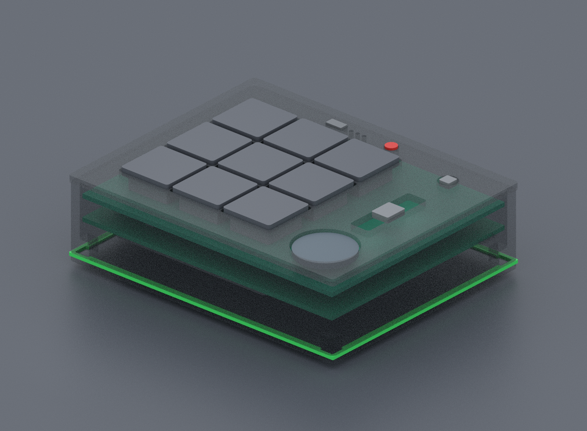

# CorePad — revisão de encaixe PCB/caixa 0.2.0

O [conjunto STEP](CorePad_Beta_PCB_match_v0.2.0.step) integra **as duas PCBs reais exportadas do KiCad 0.3.0**, base, tampa, difusor, bateria, fios de bateria, controles de reserva e volumes candidatos de componentes/FFC. Os corpos dos componentes e o espaço do FFC são envelopes simplificados; o STEP **não contém** modelos certificados dos fabricantes, suportes novos ou um cabo dobrado validado. A caixa é a mecânica 0.1.0, sem alteração das aberturas. O [manifesto](assembly_manifest.json) registra as caixas envolventes e o [relatório calculado](fit_report.json) guarda as medições.



Render técnico com a tampa transparente. Keycaps e controles mantêm volumes de reserva da mecânica anterior; o circuito visível representa apenas posicionamento.

## Datum e empilhamento (mm)

| Elemento | Z inferior | Z superior | Consequência |
|---|---:|---:|---|
| Bateria reservada | 3,0 | 10,0 | Folga até placa principal: 2,6 |
| PCB principal KiCad | 12,60 | 14,11 | Espessura exportada: 1,51, apesar de 1,6 nominal no projeto |
| Conector FFC principal | 14,11 | 16,11 | Envelope candidato de 2,0 |
| Conector FFC UI | 18,40 | 20,40 | Entra pela face inferior |
| PCB UI KiCad | 20,40 | 21,91 | Separação das placas: 6,29 |
| Corpo Choc V2 | 21,91 | 28,31 | Chega 0,09 abaixo do topo nominal da tampa; atravessa abertura |
| Tampa | 26,00 | 28,40 | Aberturas de tecla 19,6 mm para corpo de 15 mm: folga lateral nominal de 2,3 por lado |

O espaço nominal entre os corpos dos conectores FFC é **2,29 mm**. Isso não confirma inserção nem raio de dobra de um cabo 24 vias; o volume da montagem indica somente a reserva a resolver. O corpo do switch supera a face inferior da tampa intencionalmente, dentro da janela; keycap, curso, retenção e tolerâncias não foram validados.

## Choques e incompatibilidades medidos

| Interface | Resultado nominal | Ação de projeto |
|---|---|---|
| PCB principal/UI × base/tampa/bateria | 0 mm³ de interseção dos sólidos de PCB | Adicionar suportes, furos e fixação; os bosses atuais terminam em Z=7 e não sustentam as placas |
| USB-C candidato × base | **9,828 mm³** de interseção do envelope | Reposicionar conector ou redesenhar abertura traseira pela ficha dimensional e tolerâncias |
| microSD candidato × base | **2,533 mm³** de interseção do envelope | Reposicionar slot ou ampliar abertura lateral; controlar acesso ao cartão |
| P2 centro × abertura lateral | Centro candidato Z=16,61; abertura Z=14,20; **desvio +2,41 mm** | Definir jack baixo, placa auxiliar ou recortar parede; validar inserção de plug real |
| microSD altura × abertura | Corpo chega Z=15,79; abertura termina Z=15,70 | Rever 0,09 mm nominal e margem de tolerância, além do choque lateral |
| FFC 24 vias | Sem colisão do envelope reto; dobra **não verificada** | Escolher cabo com orientação A/B e raio/altura pela ficha, fazer protótipo de montagem |
| Biométrico, fader, mudo | Apenas aberturas/reservas na mecânica anterior | Escolher componentes e medir curso, contato e montagem, inclusive segurança biométrica |

Volumes são calculados por interseção de sólidos nominais, sem tolerâncias, folga de montagem ou operação. Valor 0 para corpo P2 não corrige o desalinhamento do plug. A espessura KiCad exportada de 1,51 mm deve ser confrontada com o stack-up fabricado de 1,6 mm; revisões de Z dependem desse valor.

## Reproduzir

```sh
kicad-cli pcb export step --board-only --user-origin '99x89mm' --force -o development/integration/v0.2.0/pcb_ui_v0.3.0.step development/hardware/v0.3.0/CorePad_UI_v0.3.0.kicad_pcb
kicad-cli pcb export step --board-only --user-origin '99x89mm' --force -o development/integration/v0.2.0/pcb_main_v0.3.0.step development/hardware/v0.3.0/CorePad_Main_v0.3.0.kicad_pcb
uv run --with cadquery python development/integration/v0.2.0/build_assembly.py
uv run --with cadquery python development/integration/v0.2.0/verify_fit.py
blender -b -t 4 --python development/integration/v0.2.0/render_match.py
```

Nenhum arquivo desta revisão é liberado para usinagem, molde ou pedido de placas. A próxima revisão mecânica deve partir dos footprints reais e dos volumes medidos acima, mantendo a estética Beta carbon e RGB somente na base.
